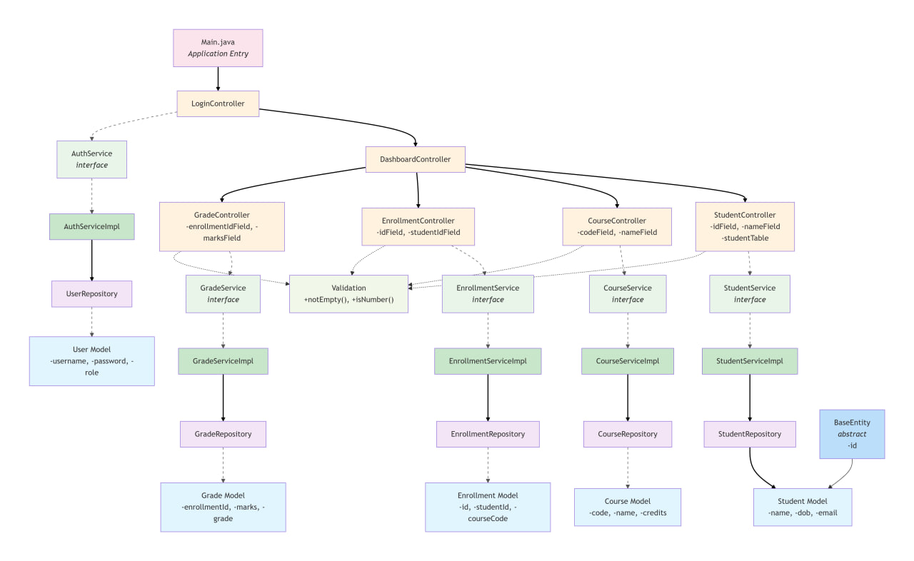

# 🎓 Student Information Management System (SIMS)

A JavaFX-based desktop application developed as a Java OOP Semester Project.
The system is designed to manage student records, courses, enrollments, and grades using a layered architecture and SOLID principles.

## 📌 Project Overview

The Student Information Management System (SIMS) provides a centralized platform for managing academic data with role-based access control.
Administrators have full CRUD privileges, while students can view their personal and academic information.

## ✨ Features

#### Core Features

- Role-based authentication (Admin & Student)

- Student management (Add, Update, Delete, View)

- Course management

- Semester-based enrollment system

- Grade assignment and calculation (A–F scale)

- Technical Features

- File-based data persistence

- Input validation and exception handling

- Clean and responsive JavaFX UI

- Persistent data storage across sessions

## 🏗️ System Architecture

The application follows a layered architecture:

* View Layer
JavaFX (FXML files + Controllers)

* Service Layer
Business logic using interfaces and implementations

* Repository Layer
File-based data access and persistence

* Model Layer
Entity classes (Student, Course, Enrollment, Grade)

## 🧠 OOP & SOLID Principles Applied
#### OOP Concepts

- Encapsulation

- Inheritance

- Polymorphism

- Abstraction

#### SOLID Principles

- Single Responsibility Principle (SRP)

- Open/Closed Principle (OCP)

- Liskov Substitution Principle (LSP)

- Interface Segregation Principle (ISP)

- Dependency Inversion Principle (DIP)

## ▶️ How to Run the Application (Windows)
#### Requirements

* JDK 21 or higher

* Running the Application

⚠️ Do NOT double-click the JAR file

* Clone the repository

Run the application using:

    run.bat

The BAT file ensures JavaFX modules are correctly loaded at runtime.

## 📦 Executable JAR

The executable JAR file is included at the project root:

    SIMS.jar

## 💾 Data Persistence

All application data is stored locally using text files:

- students.txt

- courses.txt

- enrollments.txt

- grades.txt

Files are automatically created on first application launch.

## 📄 Documentation

- 📄 **Project Report (PDF)**  
  [View the full project report](docs/SIMS-Project-Report.pdf)

- 📐 **UML Class Diagram (PNG)**
  
  

## 👥 Group Members

* Filipos Tesera

* Hilina Getnet

* Ermias Leulseged 

* Henok Assefa 

* Etsubdink Alemu 

* Gelila Getabalew 

#### 📅 Submission Date

- February 1, 2026
